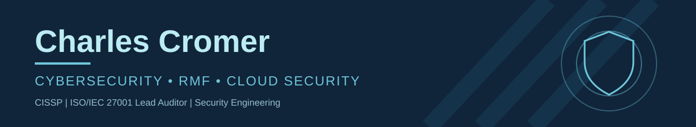

### Cybersecurity · RMF & GRC · Cloud Security

**CISSP** · **ISO/IEC 27001:2022 Lead Auditor** · **Technical Security & Risk Management**

📍 Panama City, Florida

## 👋 About Me

I'm a cybersecurity and governance, risk, and compliance (GRC) professional with **15+ years of experience supporting government technology environments**. My work connects hands-on system security with risk management: from Windows and Linux administration, vulnerability assessments, and DISA STIG hardening to DoD Risk Management Framework (RMF), authorization activities, control assessments, and audit-ready evidence.

I enjoy working at the intersection of engineering and assurance—understanding **how a system actually behaves**, determining whether its safeguards work as intended, and turning technical findings into clear, actionable risk decisions.

Today, I'm applying that foundation to **AWS, Infrastructure as Code, Policy as Code, and continuous security validation** through practical portfolio projects. My goal is to connect security requirements to configurations, automated checks, and evidence that can be independently reviewed.

## 🛡️ Areas of Expertise

| Security governance & assurance | Technical security & infrastructure |
| :--- | :--- |
| DoD RMF / ATO lifecycle | Windows Server & Red Hat Enterprise Linux |
| NIST SP 800-53 Rev. 5, DoD requirements & JSIG | VMware vSphere / ESXi |
| Security control assessment and validation | ACAS / Tenable Nessus vulnerability scanning |
| SSPs, SARs, POA&Ms, eMASS & continuous monitoring | DISA STIGs, system hardening & configuration reviews |
| Risk assessment, remediation tracking & evidence readiness | Troubleshooting, technical coordination & operational security |

### 🧰 Tools & Technologies

**Hands-on and familiar:** Windows · RHEL/Linux · VMware · ACAS/Nessus · DISA STIG Viewer · eMASS · Git · GitHub · VS Code · PowerShell

**Building practical experience:** AWS · Terraform / HCL · Python · Git-based infrastructure workflows

**On the learning roadmap:** OPA / Rego · Policy as Code · GitHub Actions / CI/CD · Automated control validation and evidence collection

> I distinguish established professional experience from technologies I'm actively learning. Project documentation identifies implemented features separately from planned work.

## 🚀 Featured Projects

### 🔐 [AWS FedRAMP 20x Security Lab](https://github.com/CharlesCromer/aws-fedramp-20x-security-lab)

A hands-on cloud security portfolio exploring how **AWS infrastructure, Terraform, policy enforcement, and repeatable verification** can help connect technical configurations with NIST SP 800-53, FedRAMP Moderate, and FedRAMP 20x security outcomes.

- **Current focus:** Terraform-managed AWS infrastructure and security configuration, validation, documentation, and repeatable change review.
- **Technology:** AWS · Terraform / HCL · Git · GitHub · PowerShell
- **Planned additions:** OPA / Rego policy checks, CI/CD controls, automated evidence collection, and cross-framework traceability.
- **Status:** Active, phased development. The repository is the source of truth for what has been implemented and verified.

**[Explore the repository →](https://github.com/CharlesCromer/aws-fedramp-20x-security-lab)**

### 🔎 [Assessment Lens — Where Compliance Meets Operational Reality](https://www.linkedin.com/posts/charlescromer_assessment-lens-start-here-ai-enabled-activity-7499970171915108352-CwsC)

An independent, **human-governed, AI-assisted GRC research and education project** translating cybersecurity developments into practical questions about controls, evidence, risk, and assessment.

- **Focus:** Security assurance · GRC · AI governance · FedRAMP · risk communication
- **Approach:** Structured research, authoritative-source review, claim validation, technical interpretation, editorial approval, and publication.
- **Governance:** AI assists with research and production; responsibility for factual validation, conclusions, and publication remains human-led.
- **Status:** Public project overview and published research; no public source-code repository linked at present.

**[Read the project overview →](https://www.linkedin.com/posts/charlescromer_assessment-lens-start-here-ai-enabled-activity-7499970171915108352-CwsC)**

### 🐝 [Hive and Honey — Business Website](https://github.com/CharlesCromer/Hive-And-Honey)

A public-facing website for an independent business. A practical project outside my primary cybersecurity work that reflects web publishing, ownership, and maintaining a real-world online presence.

- **Technology:** See repository for the implementation details.
- **Repository:** [Hive and Honey on GitHub](https://github.com/CharlesCromer/Hive-And-Honey)

<strong>🧪 Earlier Python projects — pending review</strong>

- **Weather SMS application:** College-era Python project exploring weather data and text-message notifications.
- **Thanksgiving meal planner:** Python tool for building a cooking schedule from the turkey's weight and target serving time.

These repositories are currently private. I may publish selected projects after reviewing the code, removing any sensitive information, and improving documentation.

## 🏅 Certifications & Continuing Education

**Professional certifications**

- **Certified Information Systems Security Professional (CISSP)** — ISC2
- **ISO/IEC 27001:2022 Lead Auditor** — Mastermind Assurance
- **CompTIA Security+** — CompTIA
- **CompTIA A+** — CompTIA

**Selected learning achievements and badges** *(not presented as professional certifications)*

- **AWS Well-Architected Proficient** — AWS training badge
- **Chainguard** — Vulnslayer · FIPS Frontrunner · AI Threat Tamer
- **Additional coursework** — AWS Cloud Practitioner Essentials · CMMC 2.0 · Generative AI / agentic AI

**[Browse my credentials on Credly →](https://www.credly.com/users/charles-cromer.27ec5b98)**

## 🌱 What I'm Building Toward

I'm interested in the practical connection between **security engineering and verifiable assurance**: infrastructure defined in code, security policies checked before changes reach production, control evidence generated consistently, and risk decisions based on how safeguards perform—not just how they're documented.

## 🌎 Beyond Technology

Outside of cybersecurity, I enjoy **travel, genealogy, Australian Shepherds**, and finding useful ways to learn and apply emerging technologies.

## 🤝 Connect

I'm always glad to exchange ideas about cybersecurity, RMF, cloud security, security assessment, and practical approaches to compliance.

- **LinkedIn:** [linkedin.com/in/charlescromer](https://www.linkedin.com/in/charlescromer) — preferred contact method
- **Credly:** [Professional credentials and badges](https://www.credly.com/users/charles-cromer.27ec5b98)
- **GitHub:** [github.com/CharlesCromer](https://github.com/CharlesCromer)
